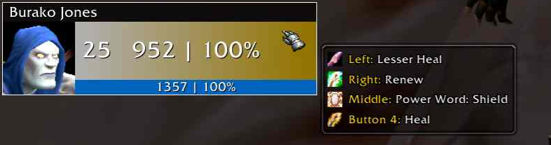

# Click Cast Plus

A World of Warcraft Forever addon that makes click casting easier to use.

## Features
- **Click Casting button on the spellbook.** It opens Blizzard's Click Casting binding window, and you can move it in the settings.
- **Cursor binding list.** When you hover over a unit frame, your click-cast bindings appear next to the cursor. The list changes when you hold Shift, Ctrl or Alt.
- **Settings window.** You can change spell icons, font size, text outline, border, background, background opacity, list offset and button position.
- **Minimap button.** Left-click opens the settings, and right-click opens Click Casting.

## Install
Download the zip from [Releases](../../releases) and extract it into `World of Warcraft\_forever_\Interface\AddOns\`.

## Commands
- `/clickcast`: toggle the Click Casting window
- `/clickcast settings`: open the settings
- `/clickcast list`: toggle the cursor list
- `/clickcast minimap`: toggle the minimap button

## Changelog
### 1.4.0
- The default list font size is now 10.
- Spell icons, border and background are now on by default.

### 1.3.0
- First release.
